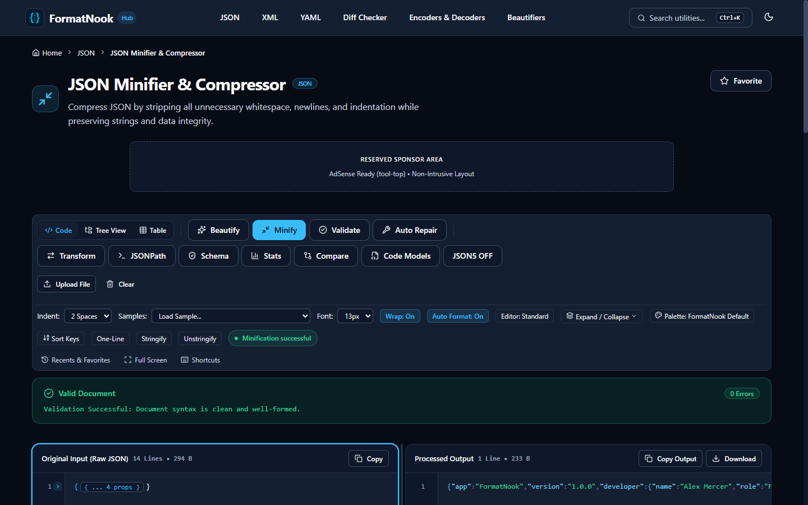

# User Guide: Mode-Independent AST JSON Folding



## 1. Feature Overview
The **Mode-Independent AST Folding Engine** allows developers to fold, collapse, and expand individual objects and arrays across **both Monaco Editor and Standalone Editor** modes, displaying collapsed summary badges with accurate property and item counts.

## 2. Purpose
Keep large, multi-thousand-line JSON documents manageable by hiding irrelevant objects or arrays while keeping critical parent context and line number coordinates intact.

## 3. When to Use It
- Inspecting top-level keys without scrolling through thousands of lines of payload data.
- Collapsing large nested arrays to focus on configuration envelopes.
- Comparing folded summaries across separate sections of a JSON document.

## 4. Step-by-Step Instructions
1. Open the JSON Workspace in either **Monaco** or **Standalone** mode.
2. In the gutter to the left of the line numbers, locate the chevron icons (`v` or `>`).
3. Click the chevron on any opening brace (`{`) or bracket (`[`).
4. The children collapse into an interactive summary badge:
   - Objects: `{ ... 4 props }`
   - Arrays: `[ ... 25 items ]`
5. Click the summary pill or chevron to expand the block back to full view.
6. Use the **Expand All** and **Collapse All** toolbar buttons to toggle the entire document at once.

## 5. Input Example
```json
{
  "system": "production-cluster",
  "metadata": {
    "version": "2.4.1",
    "region": "us-east-1",
    "active": true
  },
  "nodes": [
    "node-01.us-east-1",
    "node-02.us-east-1",
    "node-03.us-east-1"
  ]
}
```

## 6. Collapsed Display
```json
{
  "system": "production-cluster",
  "metadata": { ... 3 props },
  "nodes": [ ... 3 items ]
}
```

## 7. Available Options
- **Depth-Based Folding:** Collapse all nodes at Depth 1, Depth 2, or Depth 3 with one click.
- **Original Line Numbers:** The gutter preserves original source line numbers (skipping folded lines) so error stack traces match exactly.
- **Mode Independence:** Folding works identical in Monaco Editor and the lightweight Standalone Editor.

## 8. Keyboard Shortcuts
- `Ctrl+Shift+[`: Fold active block under cursor.
- `Ctrl+Shift+]`: Unfold active block under cursor.
- `Ctrl+K, Ctrl+0`: Fold all blocks.
- `Ctrl+K, Ctrl+J`: Unfold all blocks.

## 9. Error Handling
- Empty objects `{}` and arrays `[]` on a single line do not display chevron icons to prevent pointless empty fold ranges.
- If JSON has syntax errors, folding gracefully degrades to regular text display without crashing.

## 10. Limitations
- Standalone line folding in read-only structured view virtualizes up to ~10,000 lines; for documents exceeding 25,000 lines, use Monaco Editor mode for optimal scrolling speed.

## 11. Troubleshooting
- **Chevrons not appearing:** Ensure the document is valid JSON and formatted across multiple lines (minified single-line JSON cannot fold lines).

## 12. Related Features
- [Monaco & Standalone Editors](monaco-standalone-editors.md)
- [Beautifier & Formatter](beautifier-formatter.md)
- [Tree View](tree-view.md)
