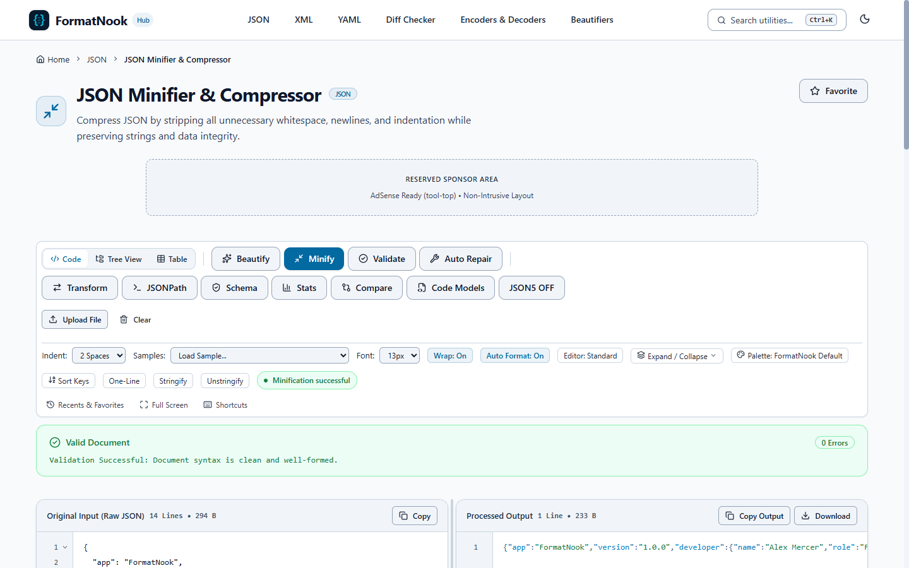

# User Guide: JSON Auto Repair Engine



## 1. Feature Overview
The **JSON Auto Repair Engine** automatically parses and corrects malformed JSON containing JavaScript-style syntax errors: single quotes, unquoted keys, trailing commas, single-line comments (`//`), and block comments (`/* */`).

## 2. Purpose
Eliminate manual cleanup of broken JSON copied from JavaScript codebases, browser consoles, configuration files, or logs.

## 3. When to Use It
- Pasting JavaScript object literals (e.g. `{ name: 'Alice', age: 30 }`) into a tool requiring strict RFC 8259 JSON.
- Stripping comments and trailing commas from `tsconfig.json` or `package.json` snippets.
- Fixing dirty logs or user inputs.

## 4. Step-by-Step Instructions
1. Paste malformed JSON into the Input Editor.
2. If syntax errors exist, the **Auto Repair** button in the toolbar becomes active (highlighted with an amber wrench icon).
3. Click **Auto Repair**.
4. The repaired, strictly valid JSON is output immediately and formatted according to your indentation preferences.

## 5. Input Example
```javascript
// Server configuration snippet
{
  host: '127.0.0.1',
  port: 8080,
  /* Security settings */
  ssl: false,
  allowedOrigins: ['localhost', 'formatnook.com',],
}
```

## 6. Expected Repaired Output
```json
{
  "host": "127.0.0.1",
  "port": 8080,
  "ssl": false,
  "allowedOrigins": [
    "localhost",
    "formatnook.com"
  ]
}
```

## 7. Available Options
- **In-Place Repair:** Overwrite input or view repaired result in output panel.
- **Auto-Formatting on Repair:** Automatically formats with current 2-space or 4-space indent rules.

## 8. Keyboard Shortcuts
- `Ctrl+Shift+R`: Trigger Auto Repair on active input.

## 9. Error Handling
- If the input is fundamentally unparseable (e.g. random binary or truncated HTML), Auto Repair reports a clear message: `"Unable to automatically repair input. Please review manual syntax diagnostics."`

## 10. Limitations
- Hexadecimal numbers (`0x1F`) and `undefined` keywords are not automatically converted to decimal/null by the standard repair engine; use **JSON5 Mode** to handle advanced non-standard values.

## 11. Troubleshooting
- **Strings with internal single quotes:** Auto Repair safely escapes internal single quotes when converting wrapping quotes to double quotes.

## 12. Related Features
- [Syntax Validator](syntax-validator.md)
- [JSON5 Mode](json5-mode.md)
- [Beautifier & Formatter](beautifier-formatter.md)
