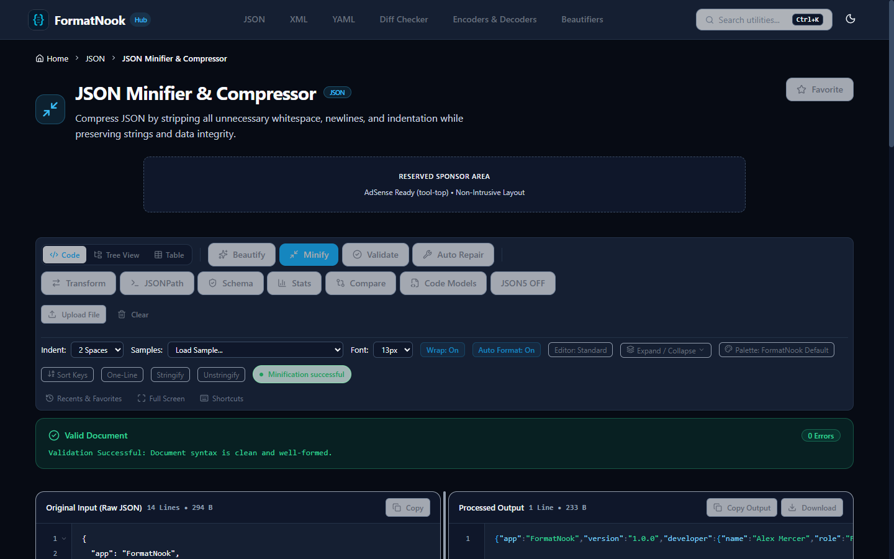

# User Guide: JSON Beautifier & Formatter



## 1. Feature Overview
The **JSON Beautifier & Formatter** reformats raw, compact, minified, or unindented JSON into clean, human-readable structured text with configurable indentation and syntax coloring.

## 2. Purpose
Enhance readability, maintain consistent code formatting across engineering teams, and prepare structured JSON payloads for code reviews, API documentation, and debugging.

## 3. When to Use It
- Inspecting unformatted single-line API responses or log traces.
- Standardizing indentation (2 spaces, 4 spaces, or tabs) before committing code.
- Verifying the structural nesting and bracket pairing of complex JSON objects.

## 4. Step-by-Step Instructions
1. Navigate to `/tools/json-formatter` or `/tools/json-minifier`.
2. Paste or type your JSON into the **Input Editor** on the left.
3. Select your preferred indentation level from the **Indent** dropdown (e.g. `2 Spaces`, `4 Spaces`, or `Tabs`).
4. Click the **Beautify** button in the toolbar (or press `Ctrl+B` / `Cmd+B`).
5. The beautified result appears in the **Output Panel** on the right with full syntax highlighting.
6. Click **Copy** or **Download** to export the result.

## 5. Input Example
```json
{"id":101,"name":"Product Alpha","active":true,"tags":["hardware","tools"],"meta":{"depth":1}}
```

## 6. Expected Output
```json
{
  "id": 101,
  "name": "Product Alpha",
  "active": true,
  "tags": [
    "hardware",
    "tools"
  ],
  "meta": {
    "depth": 1
  }
}
```

## 7. Available Options
- **Indent Size:** `2 Spaces` (default), `3 Spaces`, `4 Spaces`, or `Tabs (\t)`.
- **Auto Format Toggle:** When ON, re-formats automatically as you type (debounced at 350ms). When OFF, formats only upon clicking Beautify.
- **Editor Mode:** Monaco Editor (rich) or Standalone Editor (lightweight).

## 8. Keyboard Shortcuts
- `Ctrl+B` / `Cmd+B`: Format and Beautify document.
- `Alt+Shift+F`: VS Code standard format shortcut.
- `Ctrl+A`, then `Backspace`: Clear editor.

## 9. Error Handling
- If the input contains invalid syntax, beautification halts and an error banner displays the exact line, column, and issue description.
- The output panel retains its previous valid state to prevent destructive wiping.

## 10. Limitations
- Files exceeding 2.5 MB automatically bypass live auto-formatting to preserve main-thread responsiveness and must be formatted via manual button click (processed via background Web Worker).
- Strict standard JSON requires double-quoted property keys; single-quoted keys require running **Auto Repair** first.

## 11. Troubleshooting
- **Output didn't update after typing:** Check if Auto-Format is disabled. If disabled, click **Beautify** manually.
- **Tabs appear as spaces:** Ensure Indent dropdown is explicitly set to `Tabs` rather than a numeric space count.

## 12. Related Features
- [JSON Minifier](minifier-compressor.md)
- [Auto Repair](auto-repair.md)
- [AST Folding](ast-folding.md)
- [JSON5 Mode](json5-mode.md)
