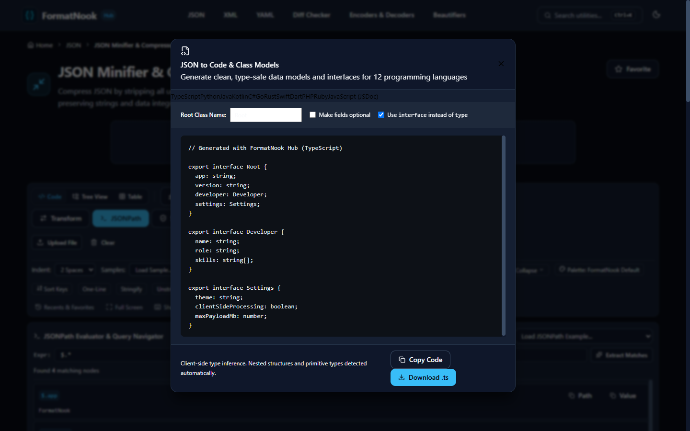

# User Guide: Multi-Language Code & Model Generator



## 1. Feature Overview
The **Multi-Language Code & Model Generator** converts any JSON payload into strongly-typed interfaces, dataclasses, structs, and models across 12 programming languages.

## 2. Purpose
Eliminate manual writing of boilerplate model classes and type definitions when integrating third-party APIs into backend and frontend applications.

## 3. When to Use It
- Converting API JSON responses into TypeScript interfaces for frontend web apps.
- Generating Python dataclasses / Pydantic models for data engineering scripts.
- Generating Go structs, Rust structs, Java POJOs, Kotlin data classes, or Swift Codable structs.

## 4. Step-by-Step Instructions
1. Paste valid JSON into the editor.
2. In the secondary toolbar, click the **Code Models** button.
3. The **JSON to Code & Class Models** modal opens.
4. Select your target language from the tab bar:
   - TypeScript
   - Python
   - Go
   - Rust
   - Java
   - Kotlin
   - C#
   - Swift
   - Dart
   - PHP
   - Ruby
   - JavaScript (JSDoc)
5. Configure model options (Root Class Name, Optional Fields, Interfaces vs Classes).
6. Click **Copy Code** or **Download File** (e.g. `root.ts`, `root.py`, `root.rs`).

## 5. Input Example
```json
{
  "user": {
    "id": 1001,
    "username": "alex_dev",
    "isStaff": true,
    "roles": ["admin", "editor"]
  }
}
```

## 6. Generated Output Examples

### TypeScript:
```typescript
export interface User {
  id: number;
  username: string;
  isStaff: boolean;
  roles: string[];
}

export interface Root {
  user: User;
}
```

### Python:
```python
from typing import List
from dataclasses import dataclass

@dataclass
class User:
    id: int
    username: str
    is_staff: bool
    roles: List[str]

@dataclass
class Root:
    user: User
```

### Rust:
```rust
use serde::{Serialize, Deserialize};

#[derive(Serialize, Deserialize, Debug)]
pub struct User {
    pub id: i64,
    pub username: String,
    pub is_staff: bool,
    pub roles: Vec<String>,
}

#[derive(Serialize, Deserialize, Debug)]
pub struct Root {
    pub user: User,
}
```

## 7. Available Options
- **Root Class Name:** Name of the top-level entity (default `Root`).
- **Optional Fields Toggle:** Marks properties as optional (`key?: type`).
- **Interfaces vs Types (TS):** Choose between `interface` and `type` definitions.

## 8. Keyboard Shortcuts
- `Tab`: Cycle through language tabs.
- Click `.json-modal-close-btn` to close.

## 9. Error Handling
- Recursion protection: Deeply nested hierarchies exceeding 50 levels safely cap and emit `{ kind: 'any' }` / `serde_json::Value` to prevent stack overflow.

## 10. Limitations
- Ambiguous types (such as empty arrays `[]`) default to `any[]` / `List[Any]`.

## 11. Troubleshooting
- **Property names with hyphens:** Identifiers like `"api-key"` are automatically converted to valid language identifier formats (or quoted).

## 12. Related Features
- [JSON Schema Validator](json-schema-validator.md)
- [Interactive Tree View](tree-view.md)
- [Beautifier & Formatter](beautifier-formatter.md)
