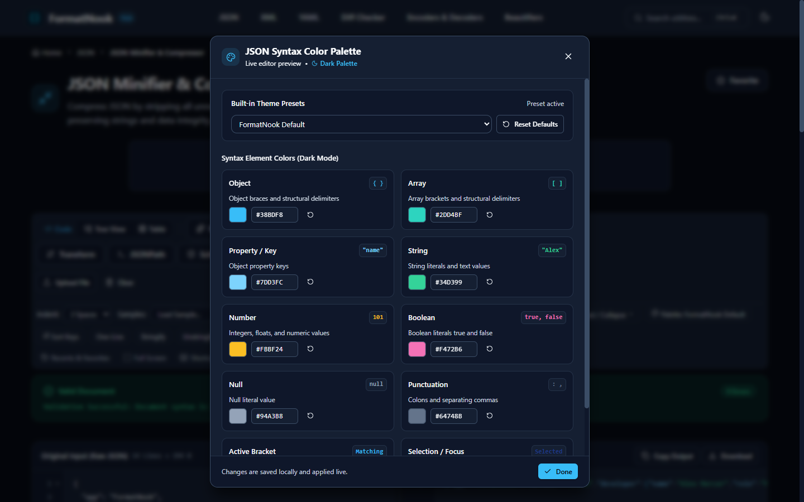

# User Guide: Customizable JSON Syntax Color Palette Engine



## 1. Feature Overview
The **Customizable JSON Syntax Color Palette Engine** enables complete visual customization of syntax tokens (property keys, strings, numbers, booleans, nulls, and delimiters) using curated built-in theme presets and custom HEX color pickers.

## 2. Purpose
Enhance readability, support accessibility and contrast requirements, and match individual developer aesthetic preferences across light and dark modes.

## 3. When to Use It
- Working in high-glare environments where higher contrast tokens are required.
- Aligning editor colors with popular developer IDE themes (e.g. Dracula, Monokai, Solarized).
- Customizing specific token categories (e.g. making strings brighter or numbers stand out).

## 4. Step-by-Step Instructions
1. Click the **Palette** button (`json-color-palette-btn`) in the editor settings toolbar.
2. The **JSON Syntax Color Palette** modal opens displaying a real-time syntax preview.
3. Select a preset from the **Theme** dropdown (e.g. `Dracula`, `Monokai`, `Solarized`, `High Contrast`).
4. To override an individual token color, enter a custom HEX code (e.g. `#00ffcc`) or use the color picker beside the category name:
   - Property / Key
   - String Literals
   - Numbers
   - Booleans
   - Null
   - Delimiters / Brackets
5. Click **Done** to apply and save your preferences.

## 5. Built-in Theme Presets
- **Default:** Clean, high-legibility theme matching modern developer tools.
- **Dracula:** Classic dark slate theme with vibrant pinks, purples, and yellows.
- **Monokai:** High-energy contrast with bright greens, oranges, and magentas.
- **Solarized (Dark/Light):** Mathematically tuned color contrasts for reduced eye fatigue.
- **High Contrast:** Pure black background with neon tokens (11:1+ WCAG AAA compliance).

## 6. Live Token Preview Example
In the preview card:
```json
{
  "status": 200,
  "message": "OK",
  "cached": true,
  "payload": null
}
```
Each token type reflects your selected HEX codes immediately.

## 7. Storage & Persistence
- All palette preferences are persisted locally in `localStorage['formatnook_json_color_palette']`.
- Preferences synchronize across both Monaco Editor and Standalone Editor tokenizers.
- Customizations are non-destructive: clicking **Reset Defaults** restores factory colors instantly.

## 8. Keyboard Shortcuts
- `Escape`: Close palette modal without saving uncommitted changes.
- `Tab`: Cycle through token HEX inputs.

## 9. Error Handling
- Invalid HEX values (e.g. `#ZZZZZZ` or `123`) are safely rejected and fall back to the last valid color, preventing broken CSS rules or application crashes.

## 10. Limitations
- Custom overrides are mode-aware: editing colors while in Dark Mode applies to the dark palette; switch to Light Mode to customize the light palette.

## 11. Troubleshooting
- **Colors didn't update in Monaco:** Ensure the theme update finished applying (Monaco re-defines tokens via its custom theme API within 50ms).
- **Want factory colors back:** Open the palette modal and click the **Reset to Defaults** button.

## 12. Related Features
- [Monaco & Standalone Editors](monaco-standalone-editors.md)
- [Beautifier & Formatter](beautifier-formatter.md)
- [Accessibility Guide](../../qa/json-workspace/accessibility-report.md)
