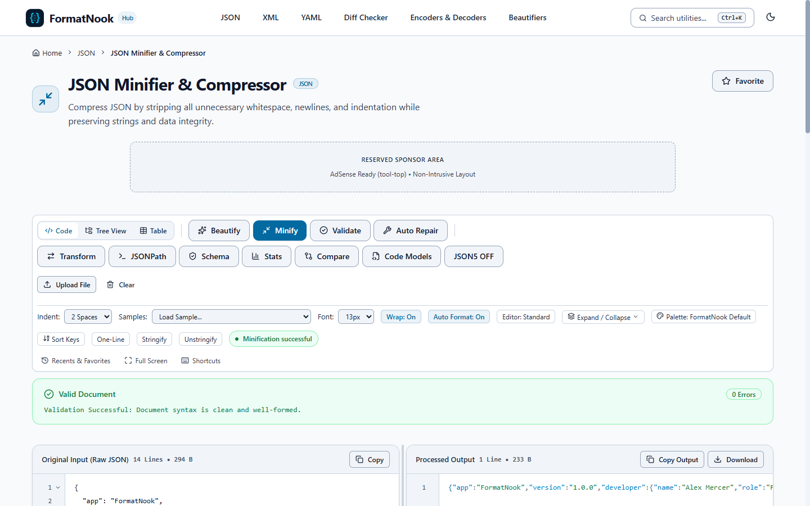

# User Guide: JSON Data Converters (CSV, XML, YAML, Flatten)



## 1. Feature Overview
The **JSON Data Converters** suite provides bidirectional and multi-format data transformations:
- **JSON to CSV:** Converts arrays of objects into RFC 4180 CSV tables.
- **JSON to XML:** Generates W3C compliant XML markup with custom root tags.
- **JSON to YAML:** Translates JSON into human-friendly YAML 1.2 syntax.
- **Flatten / Unflatten:** Converts nested objects to dot-notation keys (`user.profile.age`) and restores them.
- **Stringify / Unstringify:** Escapes JSON for embedding inside programming strings and unescapes stringified literals.

## 2. Purpose
Interoperate across different software formats, convert API data for data warehouses and spreadsheets, and transform configuration payloads between Kubernetes, Docker, and backend services.

## 3. When to Use It
- Exporting API records to Excel or Google Sheets (JSON to CSV).
- Interfacing with legacy SOAP/XML services (JSON to XML).
- Writing Ansible, Kubernetes, or GitHub Actions configs (JSON to YAML).
- Flattening deep event payloads for BigQuery or Elasticsearch indexing.

## 4. Step-by-Step Instructions
1. Paste valid JSON into the Input Editor.
2. Click the **Transform** button in the toolbar.
3. Select your target conversion action:
   - `Convert to CSV`
   - `Convert to XML`
   - `Convert to YAML`
   - `Flatten JSON`
   - `Unflatten JSON`
   - `Stringify JSON`
   - `Unstringify JSON`
4. The transformed output appears in the Output Editor.
5. Click **Download** or **Copy** to export.

## 5. Input Example
```json
{
  "server": "api-gateway",
  "ports": [80, 443],
  "config": {
    "timeout": 30,
    "ssl": true
  }
}
```

## 6. Transformed Output Examples

### YAML Output:
```yaml
server: api-gateway
ports:
  - 80
  - 443
config:
  timeout: 30
  ssl: true
```

### Flattened Output:
```json
{
  "server": "api-gateway",
  "ports[0]": 80,
  "ports[1]": 443,
  "config.timeout": 30,
  "config.ssl": true
}
```

## 7. Available Options
- **CSV Delimiter:** Comma (`,`) or Semicolon (`;`).
- **XML Root Element:** Configurable root envelope name (default `<root>`).
- **Flatten Delimiter:** Dot (`.`) or Underscore (`_`).

## 8. Keyboard Shortcuts
- `Ctrl+Shift+T`: Open Transform menu.

## 9. Error Handling
- For CSV conversion: If the input is not an array of objects, the converter automatically wraps or pivots the object so no data is dropped.
- Special characters and quotes inside strings are escaped cleanly per RFC standards.

## 10. Limitations
- XML conversion strips JSON null types or expresses them as empty elements `<key/>`.

## 11. Troubleshooting
- **YAML indentation:** YAML relies on strict 2-space indentation; do not mix tabs into YAML outputs.

## 12. Related Features
- [Table View](table-view.md)
- [Beautifier & Formatter](beautifier-formatter.md)
- [Code Models](code-model-generator.md)
