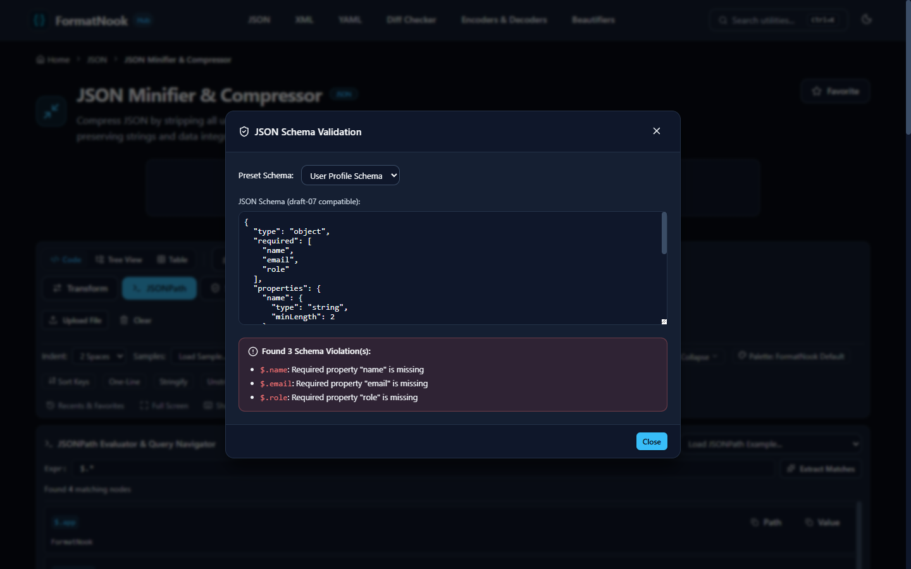

# User Guide: JSON Schema Draft-07 Validator



## 1. Feature Overview
The **JSON Schema Validator** verifies JSON documents against formal JSON Schema Draft-07 schemas, confirming required properties, data types, string formats, numeric ranges, and enum constraints.

## 2. Purpose
Ensure JSON documents adhere strictly to interface contracts, API payloads, and config specifications before passing them to backend ingestion pipelines.

## 3. When to Use It
- Validating API request payloads against OpenAPI / Swagger schemas.
- Verifying configuration files against strict team schemas.
- Testing newly authored JSON Schemas against sample datasets.

## 4. Step-by-Step Instructions
1. In the secondary toolbar, click the **Schema** button.
2. The **JSON Schema Validation** modal opens displaying two panes:
   - Left: **JSON Schema** (Draft-07 specification).
   - Right: **Instance Data** (pre-loaded with active editor contents).
3. Paste or edit your JSON Schema in the left editor.
4. Validation runs continuously in real time.
5. If valid: A green **Schema Conformance Verified** banner appears.
6. If invalid: A red failure notice pins the exact violation, property path, and schema keyword constraint (e.g. `requires property 'id'`).

## 5. Input Instance & Schema Example

### JSON Instance:
```json
{
  "userId": 501,
  "email": "user@formatnook.com"
}
```

### JSON Schema:
```json
{
  "$schema": "http://json-schema.org/draft-07/schema#",
  "type": "object",
  "required": ["userId", "email"],
  "properties": {
    "userId": { "type": "integer", "minimum": 1 },
    "email": { "type": "string", "format": "email" }
  }
}
```

## 6. Expected Diagnostic Output
- **Result:** `PASS — All 2 required properties match type constraints.`

## 7. Supported Schema Keywords
- `type`: `string`, `number`, `integer`, `boolean`, `array`, `object`, `null`.
- `required`: Array of mandatory property names.
- `properties` / `additionalProperties`: Property shape validation.
- `minimum` / `maximum` / `exclusiveMinimum`: Numeric boundaries.
- `enum`: Explicit allowed value lists.
- `format`: `email`, `uri`, `date-time`, `uuid`.

## 8. Keyboard Shortcuts
- `Ctrl+Enter`: Validate immediately.
- `Escape`: Close schema modal.

## 9. Error Handling
- If the schema itself is malformed JSON, an error informs the developer: `"Invalid JSON Schema syntax"`.
- Missing required fields report the exact property name and schema path.

## 10. Limitations
- Optimized for Draft-07; external network `$ref` URI resolution is disabled to protect client-side privacy.

## 11. Troubleshooting
- **Integer vs Number:** If a schema specifies `type: "integer"`, passing `42.5` will fail; use `type: "number"` for floating-point values.

## 12. Related Features
- [Syntax Validator](syntax-validator.md)
- [Code Model Generator](code-model-generator.md)
- [Metrics & Statistics](metrics-statistics.md)
