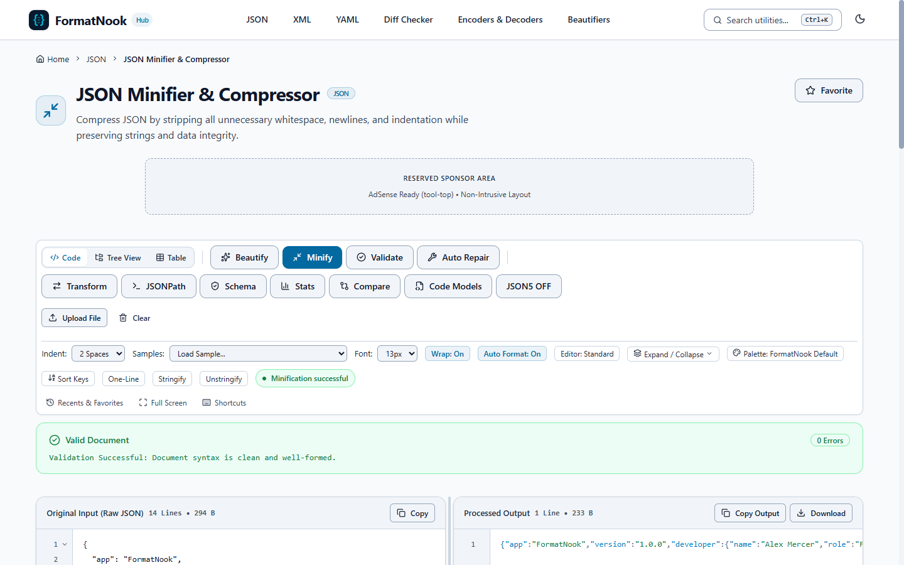

# User Guide: JSON5 Relaxed Syntax Mode



## 1. Feature Overview
**JSON5 Relaxed Syntax Mode** toggles support for the official JSON5 specification (ES5-compatible JSON extension), allowing single-line comments (`//`), multi-line block comments (`/* */`), unquoted identifiers, single-quoted strings, hexadecimal numbers (`0x1F`), trailing commas, and leading decimal points.

## 2. Purpose
Work seamlessly with modern configuration formats (such as Babel, Webpack, TSConfig, and Next.js configs) that use JSON5 syntax without triggering syntax errors.

## 3. When to Use It
- Editing `tsconfig.json` or `.eslintrc` files containing comments.
- Working with hardware / embedded datasets with hexadecimal addresses (`0xFF00`).
- Converting human-friendly JSON5 configs into strict standard RFC 8259 JSON for legacy systems.

## 4. Step-by-Step Instructions
1. In the secondary toolbar, locate the **JSON5** button (displays `JSON5 OFF` by default).
2. Click the button to toggle it to `JSON5 ON` (highlighted in teal).
3. The parser switches to the relaxed JSON5 engine.
4. Comments, trailing commas, unquoted keys, and hex numbers are now treated as valid syntax.
5. To export as strict standard JSON, click **Convert JSON5 to Standard JSON**.

## 5. Input Example (Valid JSON5)
```javascript
{
  // Primary connection settings
  host: '127.0.0.1',
  port: 0x1F90, // Hexadecimal 8080
  debug: true,
  /* Trailing commas are allowed */
  whitelist: [
    'internal.net',
    'vpn.corp',
  ],
}
```

## 6. Converted Standard JSON Output
```json
{
  "host": "127.0.0.1",
  "port": 8080,
  "debug": true,
  "whitelist": [
    "internal.net",
    "vpn.corp"
  ]
}
```

## 7. Supported JSON5 Features
- **Comments:** Single-line (`//`) and block (`/* ... */`).
- **Quotes:** Single quotes (`'`) and unquoted keys.
- **Numbers:** Hexadecimal (`0x...`), leading/trailing decimals (`.5`, `5.`), Infinity, NaN.
- **Whitespace:** ECMAScript 5 identifier whitespace rules.

## 8. Keyboard Shortcuts
- `Ctrl+Alt+5`: Toggle JSON5 Mode.

## 9. Error Handling
- Invalid tokens that violate even JSON5 rules (such as unclosed strings or mismatched brackets) report precise line and column diagnostics.

## 10. Limitations
- Strict JSON APIs will reject JSON5 files directly; always use **Convert to Standard JSON** before sending payloads to standard HTTP endpoints.

## 11. Troubleshooting
- **Hex numbers converted to decimal:** Standard JSON does not support hex numbers; when converting to standard JSON, `0x1F90` is mathematically converted to `8080`.

## 12. Related Features
- [Auto Repair](auto-repair.md)
- [Syntax Validator](syntax-validator.md)
- [Beautifier & Formatter](beautifier-formatter.md)
