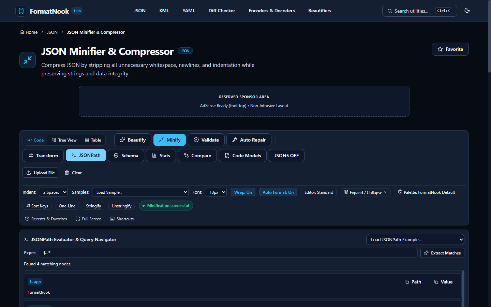

# User Guide: JSONPath Query Evaluator & Extraction



## 1. Feature Overview
The **JSONPath Query Evaluator** allows developers to query, filter, and extract specific values or sub-trees from complex JSON documents using standard JSONPath syntax (e.g. `$.store.book[*].author`).

## 2. Purpose
Quickly isolate targeted records, test backend JSONPath expressions, and extract slices of complex payloads without writing custom JavaScript scripts.

## 3. When to Use It
- Testing JSONPath expressions before adding them to API gateway routing rules or Kubernetes configurations.
- Extracting specific fields (e.g. all email addresses or all order IDs) from multi-megabyte API logs.
- Filtering array elements based on predicate expressions (e.g. `?(@.price < 20)`).

## 4. Step-by-Step Instructions
1. In the secondary toolbar, click the **JSONPath** button.
2. The JSONPath drawer slides in from the bottom.
3. Enter your query in the **Expression** input (default `$` extracts the entire document).
4. The **Matches** panel instantly updates with the extracted elements.
5. Click **Copy Result** to copy the extracted subset to your clipboard.
6. Click **Load into Editor** to replace the workspace output with the extracted query results.

## 5. Input Example
```json
{
  "store": {
    "books": [
      { "title": "Clean Code", "price": 32.50, "category": "software" },
      { "title": "Design Patterns", "price": 45.00, "category": "software" },
      { "title": "The Hobbit", "price": 14.99, "category": "fiction" }
    ]
  }
}
```

## 6. Query & Expected Matches
- **Query:** `$.store.books[?(@.price < 40)].title`
- **Output:**
  ```json
  [
    "Clean Code",
    "The Hobbit"
  ]
  ```

## 7. Supported JSONPath Syntax
- `$`: Root object / element.
- `.`: Child operator (e.g. `$.store.books`).
- `..`: Recursive descent (deep search anywhere in graph).
- `*`: Wildcard (all properties or elements).
- `[start:end:step]`: Array slice operator.
- `[?(@.prop == val)]`: Predicate filter expressions.

## 8. Keyboard Shortcuts
- `Enter` inside Expression input: Force re-evaluation.
- `Escape`: Close JSONPath panel.

## 9. Error Handling
- Invalid syntax (e.g. unclosed brackets `$[?(@.`) displays an inline red warning badge: `"Invalid JSONPath expression"`.
- If a query matches zero nodes, an informative message states: `"0 matches found for expression"`.

## 10. Limitations
- Evaluates against valid standard JSON; if the editor contains syntax errors, resolve them first.

## 11. Troubleshooting
- **No matches returned for a key:** Property names are case-sensitive; check that casing matches the document exactly.

## 12. Related Features
- [Tree View](tree-view.md)
- [JSON Schema Validator](json-schema-validator.md)
- [Beautifier & Formatter](beautifier-formatter.md)
