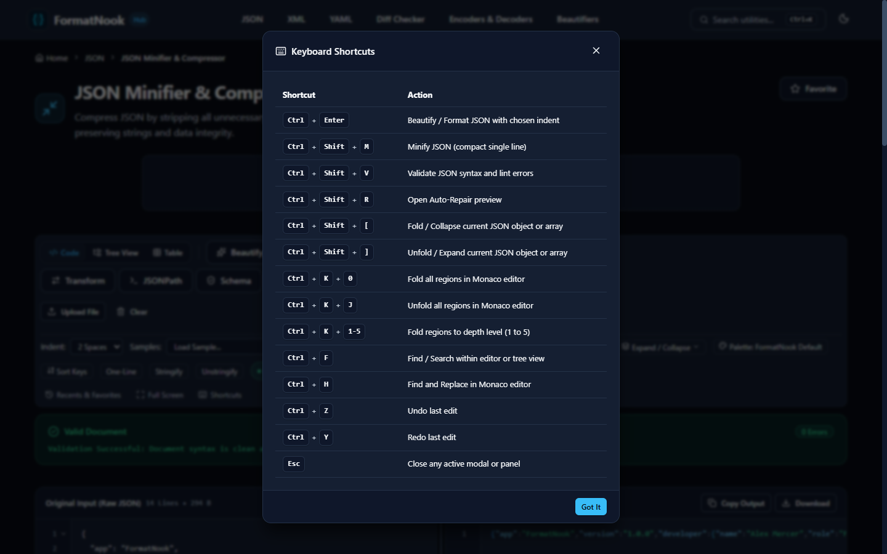

# User Guide: JSON Workspace Keyboard Shortcuts & Productivity Guide

## 1. Feature Overview
The **Keyboard Shortcuts System** provides high-efficiency keybindings for primary transformations, folding, editor navigation, find/replace, and modal management.

## 2. Purpose
Enable mouse-free, high-velocity developer workflows for power users and engineers working with large JSON codebases.

## 3. Keyboard Cheat Sheet

### Primary Actions
| Shortcut | Action | Description |
|---|---|---|
| `Ctrl+B` / `Cmd+B` | **Beautify / Format** | Formats document with current indentation settings |
| `Ctrl+M` / `Cmd+M` | **Minify** | Compresses document into single RFC 8259 line |
| `Alt+Shift+F` | **VS Code Format** | Alternate standard formatting keybinding |
| `Ctrl+Alt+V` | **Validate** | Triggers strict syntax validation check |
| `Ctrl+Shift+R` | **Auto Repair** | Automatically repairs comments, trailing commas & single quotes |
| `Ctrl+Shift+T` | **Transform Menu** | Opens data transformation modal |
| `Ctrl+Alt+5` | **JSON5 Toggle** | Toggles relaxed JSON5 syntax mode |

### Folding & Hierarchy
| Shortcut | Action | Description |
|---|---|---|
| `Ctrl+Shift+[` | **Fold Region** | Collapses object/array block under cursor |
| `Ctrl+Shift+]` | **Unfold Region** | Expands folded object/array block under cursor |
| `Ctrl+K, Ctrl+0` | **Fold All** | Collapses all collapsible ranges across document |
| `Ctrl+K, Ctrl+J` | **Unfold All** | Expands all collapsed ranges |

### Editor & Navigation
| Shortcut | Action | Description |
|---|---|---|
| `Ctrl+F` / `Cmd+F` | **Find** | Opens in-editor search query bar |
| `Ctrl+H` / `Cmd+H` | **Replace** | Opens find and replace bar |
| `F11` | **Full Screen** | Toggles workspace between windowed and full screen |
| `Tab` | **Indent** | Inserts 2 spaces (or tabs) at cursor |
| `Shift+Tab` | **Outdent** | Removes 2 spaces at cursor |
| `?` or `F1` | **Help Cheat Sheet** | Opens the Keyboard Shortcuts guide modal |
| `Escape` | **Dismiss** | Closes active modal, drawer, or search bar |

## 4. Modal Shortcuts Guide
Pressing `?` in the workspace opens the **JsonShortcutsModal** dialog (`screenshots/json-shortcuts-modal.png`), displaying this complete reference directly within the application.

## 5. Related Features
- [Monaco & Standalone Editors](monaco-standalone-editors.md)
- [AST Folding](ast-folding.md)
- [Beautifier & Formatter](beautifier-formatter.md)
