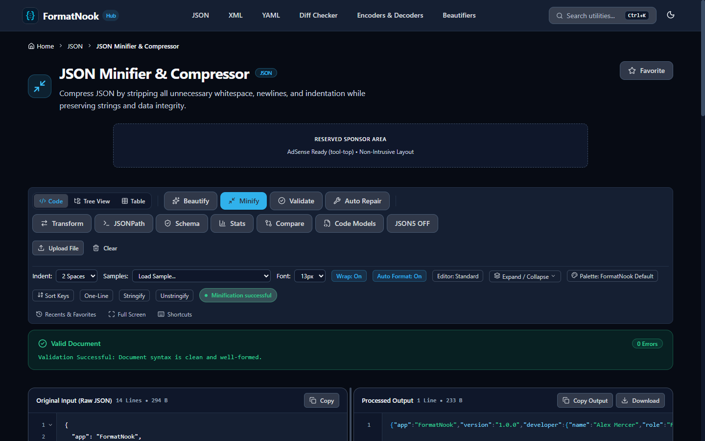

# User Guide: JSON Minifier & Compressor



## 1. Feature Overview
The **JSON Minifier & Compressor** strips all unnecessary whitespace, newline characters, indentation, and trailing spaces from a JSON document, producing a strict, single-line ECMAScript/RFC 8259 compliant string.

## 2. Purpose
Reduce payload byte size for efficient network transmission, reduce memory storage requirements in Redis/databases, and prepare compact configurations for embedding in environment variables.

## 3. When to Use It
- Pre-compressing API response bodies before wire transfer.
- Storing JSON payloads into relational database `VARCHAR` or `TEXT` columns.
- Preparing one-line payloads for `curl` commands and shell scripts.

## 4. Step-by-Step Instructions
1. Open the JSON Workspace at `/tools/json-minifier`.
2. Enter or paste multi-line JSON into the Input Editor.
3. Click the **Minify** button on the toolbar (or press `Ctrl+M` / `Cmd+M`).
4. The compressed, single-line result appears immediately in the Output Panel.
5. The status footer displays byte savings and percentage reduction (e.g. `Reduced by 42%`).
6. Click **Copy** to place the minified string on your clipboard.

## 5. Input Example
```json
{
  "service": "authentication",
  "port": 8080,
  "endpoints": [
    "/login",
    "/signup",
    "/refresh"
  ],
  "sslEnabled": true
}
```

## 6. Expected Output
```json
{"service":"authentication","port":8080,"endpoints":["/login","/signup","/refresh"],"sslEnabled":true}
```

## 7. Available Options
- **One-Line Escape:** Minifies without altering internal string literals.
- **Worker Execution:** For files $> 2.5\text{ MB}$, minification automatically runs inside an isolated Web Worker to keep the browser UI silky smooth.

## 8. Keyboard Shortcuts
- `Ctrl+M` / `Cmd+M`: Minify JSON document.
- `Ctrl+Shift+C`: Copy output to clipboard.

## 9. Error Handling
- If the document contains syntax errors, minification is halted and a syntax diagnostics badge highlights the error coordinates.
- Whitespace and characters inside string values (e.g. `"hello   world\n"`) are strictly preserved.

## 10. Limitations
- Minifying does not alter property key names or shorten identifiers; only structural whitespace is stripped.
- For files $> 25\text{ MB}$, allow 50–100ms for worker string serialization.

## 11. Troubleshooting
- **Spaces inside my string disappeared:** Double-check if your JSON string had unescaped quotes. Quotes inside strings must be escaped with `\"`.
- **Output still wraps visually:** Ensure the **Wrap** button in the editor toolbar is toggled according to your preference (`Wrap: OFF` prevents horizontal line folding).

## 12. Related Features
- [JSON Beautifier](beautifier-formatter.md)
- [One-Line JSON](beautifier-formatter.md)
- [Stringify JSON](data-converters.md)
