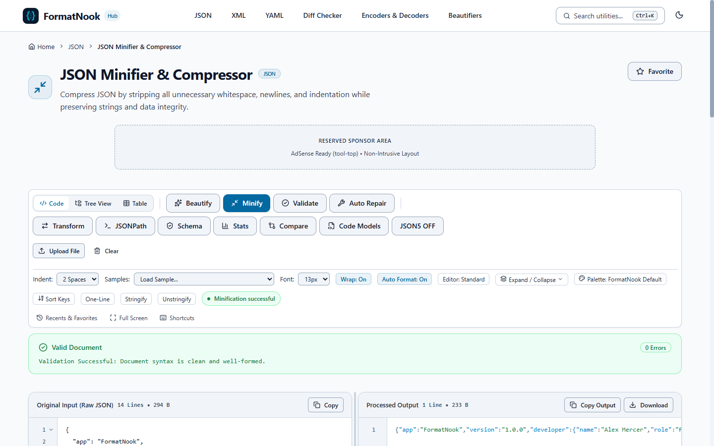

# User Guide: Monaco Editor & Standalone Editor Dual Architecture

## 1. Feature Overview
FormatNook Hub provides two independent, high-grade editor engines:
1. **Monaco Editor:** The full-featured code editor engine that powers VS Code, complete with line numbers, code minimap, multi-cursor, bracket matching, and native AST folding.
2. **Standalone Editor:** A zero-dependency, ultra-lightweight custom textarea/structured editor designed for instant loading, battery efficiency, and accessibility on low-power or mobile devices.

## 2. Purpose
Give developers the freedom to choose between maximum IDE editing capabilities (Monaco) and instant, zero-overhead performance (Standalone) without sacrificing folding, syntax highlighting, or state.

## 3. When to Use It
- **Use Monaco:** When editing complex code, using multi-cursor selection, viewing line minimaps, or editing large files ($> 5\text{ MB}$) where virtualized scrolling is essential.
- **Use Standalone:** On mobile phones, older laptops, low-bandwidth connections, or when you need zero memory overhead.

## 4. Step-by-Step Instructions
1. In the secondary toolbar, find the **Editor Mode** dropdown or toggle button.
2. Select **Monaco** or **Standalone**.
3. The editor immediately swaps engines.
4. Your document text, cursor position, and active fold ranges are preserved bit-for-bit without reload.

## 5. Feature Comparison Matrix

| Feature / Capability | Monaco Editor | Standalone Editor |
|---|:---:|:---:|
| **Engine Dependency** | `@monaco-editor/react` (~2 MB bundle) | Zero dependency (pure React + DOM) |
| **Initial Load Latency** | ~150–300 ms (CDN / Worker load) | **0 ms (Instant)** |
| **AST Line Folding** | Yes (`editor.fold` adapter) | Yes (`.standalone-structured-view`) |
| **Line Number Gutter** | Yes (Monaco margin) | Yes (Dynamic CSS counter gutter) |
| **Tab Key Interception** | Yes (Configurable spaces) | Yes (Inserts 2 spaces) |
| **Color Palette Theming** | Yes (Monaco theme definition) | Yes (CSS variables) |
| **Multi-Cursor Editing** | Yes (`Alt+Click`) | Single cursor |
| **Large File Virtualization**| Excellent ($> 50,000$ lines) | Good (Up to ~10,000 lines) |

## 6. Bidirectional State Synchronization
Switching from `Monaco` $\rightarrow$ `Standalone` $\rightarrow$ `Monaco` retains:
- Complete document character fidelity (including Unicode and escaped quotes).
- All active collapsed line ranges.
- Formatter output state and error diagnostic badges.

## 7. Keyboard Shortcuts
- `Tab`: Inserts spaces in both editors.
- `Ctrl+F` / `Cmd+F`: Open Find and Replace.
- `F11` or Fullscreen Button: Maximize editor to fill 100% viewport.

## 8. Error Handling
- If Monaco fails to load due to ad-blockers or strict offline CSP rules, FormatNook Hub automatically falls back to the Standalone Editor with zero user interruption.

## 9. Limitations
- Multi-cursor editing (`Alt+Click`) is exclusive to Monaco Editor.

## 10. Troubleshooting
- **Monaco feels laggy on battery power:** Switch to **Standalone** mode for instant 60fps responsiveness.

## 11. Related Features
- [AST Folding](ast-folding.md)
- [Color Palette Engine](color-palette-engine.md)
- [Keyboard Shortcuts](keyboard-shortcuts.md)
