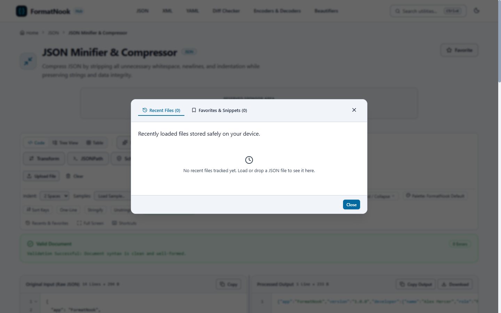

# User Guide: Recent Snippets, Favorites & Local Storage

## 1. Feature Overview
The **Recent Snippets & Favorites** manager stores, recalls, and manages named JSON snippets locally on your machine without requiring user accounts or sending data to external cloud databases.

## 2. Purpose
Maintain a fast local scratchpad of frequently used JSON templates, API payloads, mock responses, and test fixtures.

## 3. When to Use It
- Saving work-in-progress snippets across browser tabs and sessions.
- Bookmarking standard development payloads (e.g. auth tokens, test orders, webhook templates).
- Recalling previously formatted documents after closing the browser.

## 4. Step-by-Step Instructions
1. When you have a JSON document you wish to save, click **Recents & Favorites** in the upper right toolbar (`recents-modal-btn`).
2. In the **Save Current Snippet** field, enter a name (e.g. `Prod Webhook Sample`).
3. Click **Save**.
4. The snippet appears in your saved snippets list with a timestamp and byte size.
5. To restore a snippet, click on its row in the list; it immediately loads into the editor.
6. To delete a snippet, click the trash icon next to the item.

## 5. Storage Architecture & Quota Safety
- **100% Client-Side:** Snippets reside exclusively in your browser's `window.localStorage` under the key `'formatnook_recent_snippets'`.
- **Quota Safeguard:** If your browser storage is exhausted, the storage service catches `QuotaExceededError` safely and renders an explicit warning banner (`"Storage quota exceeded. Please delete older snippets."`) rather than failing silently or crashing the editor.

## 6. Keyboard Shortcuts
- `Escape`: Close Recents dialog.
- `Tab`: Cycle through saved snippets.

## 7. Error Handling
- Corrupted or invalid JSON inside `localStorage` is automatically detected, sanitized, and safely pruned on mount without blanking the workspace.

## 8. Limitations
- Stored snippets are scoped to your local browser origin (`http://localhost` or `https://formatnook.com`). They do not synchronize across different computers or incognito windows.

## 9. Troubleshooting
- **Can't find a snippet in another browser:** LocalStorage is browser-specific; export snippets as `.json` files via the **Download** button to transfer them.
- **Quota warning banner appears:** Click **Clear All** or delete older large snippets to free local storage space.

## 10. Related Features
- [Beautifier & Formatter](beautifier-formatter.md)
- [Monaco & Standalone Editors](monaco-standalone-editors.md)
- [Privacy & Security Guide](../../qa/json-workspace/privacy-report.md)
