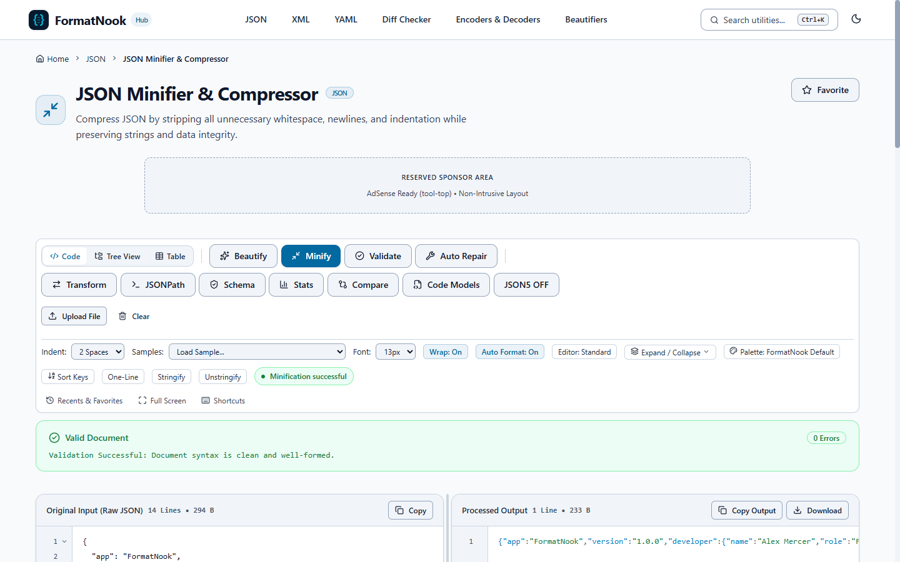

# User Guide: JSON Syntax Validator & Error Diagnostics



## 1. Feature Overview
The **JSON Syntax Validator** rigorously verifies input text against RFC 8259 and ECMA-404 standards. When syntax issues are detected, it pins the exact line number, column offset, and token error description.

## 2. Purpose
Quickly identify and resolve syntax violations (such as missing brackets, unquoted keys, single quotes, or trailing commas) that cause backend API failures and runtime parse exceptions.

## 3. When to Use It
- Validating hand-edited configuration files before deploying.
- Troubleshooting `"Unexpected token"` exceptions received from server logs.
- Pre-checking customer-submitted JSON payloads before running automated tests.

## 4. Step-by-Step Instructions
1. Navigate to `/tools/json-validator` or `/tools/json-minifier`.
2. Paste your raw JSON into the Input Editor.
3. Click the **Validate** button (or press `Ctrl+Alt+V`).
4. If valid: A green **Valid JSON** badge appears in the status bar with document metrics.
5. If invalid: A red error notification appears directly below the editor detailing the line, column, and exact failure reason.

## 5. Input Example (Malformed)
```json
{
  "name": "FormatNook",
  "version": 1.0,
  "active": true,
}
```

## 6. Expected Diagnostic Output
```
Line 5, Column 1: Unexpected token }. Likely a trailing comma or misplaced bracket.
```

## 7. Available Options
- **Live Real-Time Validation:** Automatically validates as you type (350ms debounce).
- **Strict vs Relaxed Mode:** Switch between strict standard JSON and relaxed JSON5 mode (supporting comments and hex values).

## 8. Keyboard Shortcuts
- `Ctrl+Alt+V`: Force immediate syntax validation.
- `F8`: Jump to next error marker in Monaco Editor.

## 9. Error Handling
- Pins character coordinates even when `JSON.parse` returns generic V8 errors.
- Categorizes common human errors:
  - Trailing commas in objects or arrays.
  - Single quotes (`'`) instead of double quotes (`"`).
  - Unquoted property identifiers.
  - Unclosed strings and unescaped line breaks.

## 10. Limitations
- Checks structural and syntax compliance only. To validate data types, required properties, and schemas, use the **JSON Schema Validator**.

## 11. Troubleshooting
- **Error reports line 1 for a multi-line document:** Ensure line endings are standard `\n` or `\r\n`.
- **Can't fix complex syntax errors:** Click the **Auto Repair** button to automatically fix single quotes, comments, and trailing commas in one click.

## 12. Related Features
- [Auto Repair](auto-repair.md)
- [JSON Schema Validator](json-schema-validator.md)
- [JSON5 Mode](json5-mode.md)
