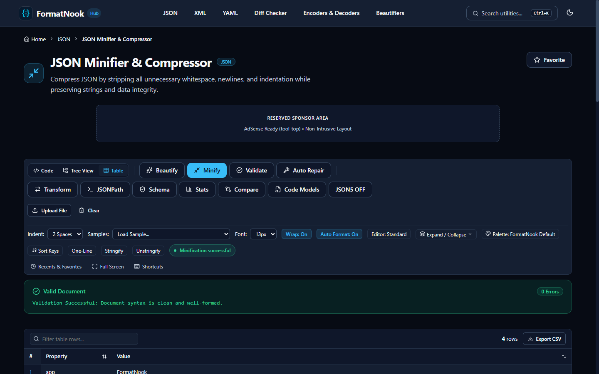

# User Guide: Interactive JSON Table View



## 1. Feature Overview
The **Interactive Table View** parses arrays of JSON objects into a sortable, searchable, and paginated relational table with one-click RFC 4180 CSV export.

## 2. Purpose
Analyze tabular JSON collections (e.g. database rows, product catalogs, customer rosters) in a spreadsheet-style grid without requiring external tools like Excel or Google Sheets.

## 3. When to Use It
- Inspecting uniform or semi-uniform arrays of objects.
- Sorting records by numerical values (e.g. price, date, ID) or alphabetical strings.
- Filtering rows by search queries and exporting the filtered dataset directly to CSV.

## 4. Step-by-Step Instructions
1. In the view mode selector, click the **Table** tab.
2. The JSON array is automatically analyzed and columns are generated from object keys.
3. Click any column header to sort ascending or descending.
4. Use the search input at the top right of the table to filter rows in real time.
5. Use pagination controls at the bottom to page through large collections.
6. Click **Export CSV** to download the table directly as a `.csv` file.

## 5. Input Example
```json
[
  { "id": 1, "sku": "KB-100", "title": "Mechanical Keyboard", "stock": 45, "price": 89.99 },
  { "id": 2, "sku": "MS-200", "title": "Wireless Gaming Mouse", "stock": 120, "price": 49.50 },
  { "id": 3, "sku": "MN-400", "title": "4K Ultra-Wide Monitor", "stock": 18, "price": 399.00 }
]
```

## 6. Expected Table View
| ID | SKU | Title | Stock | Price |
|---|---|---|---|---|
| 1 | KB-100 | Mechanical Keyboard | 45 | $89.99 |
| 2 | MS-200 | Wireless Gaming Mouse | 120 | $49.50 |
| 3 | MN-400 | 4K Ultra-Wide Monitor | 18 | $399.00 |

## 7. Available Options
- **Page Size:** Default 50 rows per page.
- **Search Filtering:** Global search across all column values.
- **Copy Cell Value:** Click any cell to copy its contents to clipboard.
- **CSV Export:** Client-side CSV generation compliant with RFC 4180.

## 8. Keyboard Shortcuts
- `Tab` / `Shift+Tab`: Navigate across table cells and pagination buttons.
- `Alt+Down` / `Alt+Up`: Page forward and backward.

## 9. Error Handling
- If the JSON input is a single object rather than an array, Table View renders a 2-column `Property` vs `Value` key-value table.
- If the JSON input is a primitive or malformed, a notice prompts the user to supply a JSON array.

## 10. Limitations
- Deeply nested objects within table cells are displayed as serialized JSON strings; use **Tree View** for exploring deep sub-hierarchies.

## 11. Troubleshooting
- **Missing columns for some rows:** If an object in the array lacks a property present in other objects, Table View leaves the cell blank without crashing.

## 12. Related Features
- [Tree View](tree-view.md)
- [JSON to CSV Converter](data-converters.md)
- [Code View](beautifier-formatter.md)
