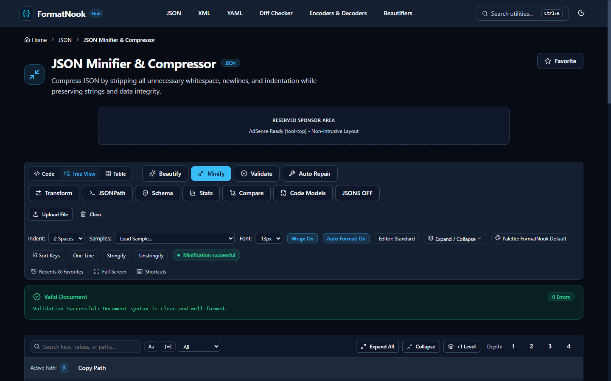

# User Guide: Interactive JSON Tree View



## 1. Feature Overview
The **Interactive Tree View** transforms flat code into an interactive, hierarchical AST (Abstract Syntax Tree) visualizer with expandable/collapsible nodes, live search filtering, and inline value editing.

## 2. Purpose
Navigate deeply nested JSON payloads effortlessly, visually inspect complex object graphs, and edit leaf values without accidentally deleting brackets or syntax punctuation.

## 3. When to Use It
- Exploring complex API schemas with $> 5$ levels of nesting.
- Filtering large objects to locate specific properties (e.g. `"status"`, `"price"`, or `"id"`).
- Safely modifying primitive values without breaking JSON formatting.

## 4. Step-by-Step Instructions
1. Paste or load JSON into the workspace.
2. In the view mode switcher at the top left of the editor, click **Tree View**.
3. Click any node chevron (`>` or `v`) to expand or collapse child objects or arrays.
4. Type in the **Search Tree** bar to highlight matching properties in real time.
5. Double-click any leaf value (string, number, boolean) to edit it directly. Press `Enter` or click checkmark to commit.
6. Switch back to **Code View** to see your edits synchronized in code.

## 5. Input Example
```json
{
  "system": "OrderProcessing",
  "batch": {
    "id": 99281,
    "records": [
      { "item": "Keyboard", "qty": 2, "shipped": true },
      { "item": "Mouse", "qty": 1, "shipped": false }
    ]
  }
}
```

## 6. Expected Interactive Display
- Root node: `{ system, batch }`
  - `batch`: `{ id: 99281, records [2 items] }`
    - `[0]`: `{ item: "Keyboard", qty: 2, shipped: true }`
    - `[1]`: `{ item: "Mouse", qty: 1, shipped: false }`

## 7. Available Options
- **Expand All / Collapse All:** Expand all nodes up to the safe 2,500 node cap, or collapse to root.
- **Search Filtering:** Search keys, values, or both.
- **Copy Path:** Hover over any node and click Copy Path to copy its exact JSONPath (e.g. `$.batch.records[0].qty`).

## 8. Keyboard Shortcuts
- `ArrowDown` / `ArrowUp`: Move focus across tree nodes.
- `ArrowRight`: Expand selected node.
- `ArrowLeft`: Collapse selected node.
- `Enter`: Edit selected node value.

## 9. Error Handling
- If input is not valid JSON, Tree View displays an error banner and invites the user to return to Code View to repair the syntax.
- Empty objects `{}` and arrays `[]` render with clean empty badges (`{ 0 props }`, `[ 0 items ]`).

## 10. Limitations
- `Expand All` caps expansion at 2,500 nodes to prevent browser DOM freezing on massive datasets (e.g. $> 10\text{ MB}$).

## 11. Troubleshooting
- **Search doesn't highlight nested items:** Ensure the parent node is expanded, or clear search scope filters.
- **Can't edit an object key name:** Direct inline editing is supported on leaf values; to rename property keys, use Code View or the Transform tool.

## 12. Related Features
- [Table View](table-view.md)
- [AST Folding](ast-folding.md)
- [JSONPath Evaluator](jsonpath-evaluator.md)
